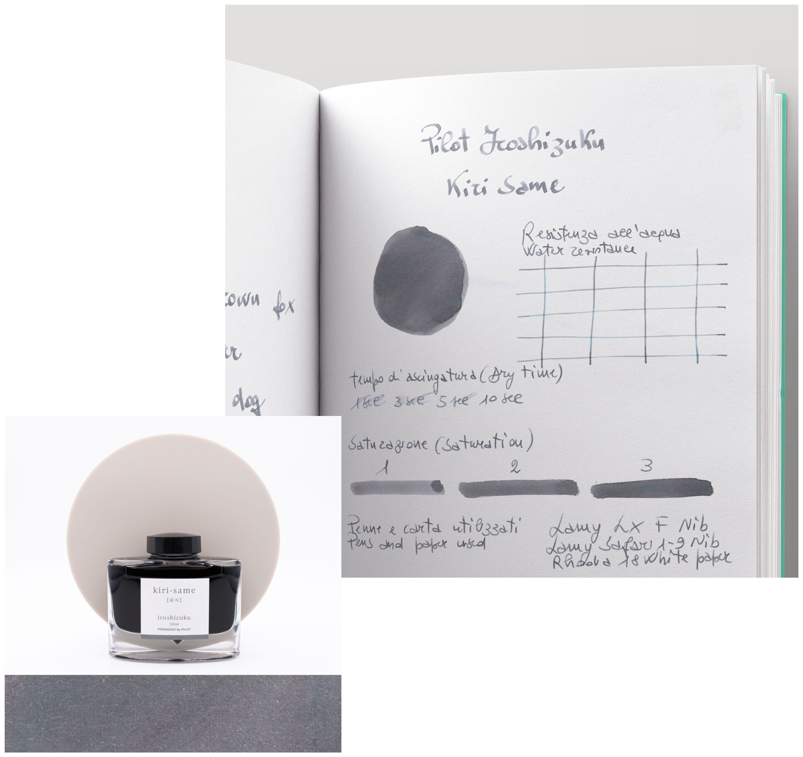
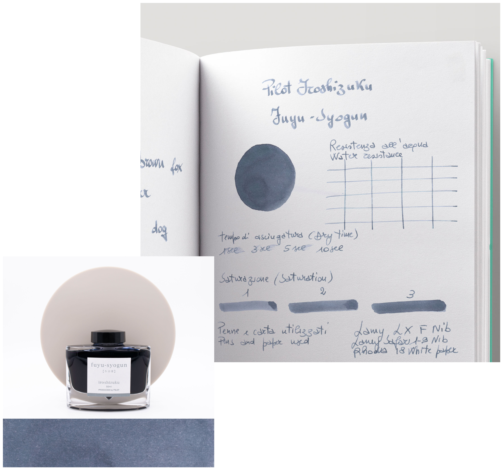
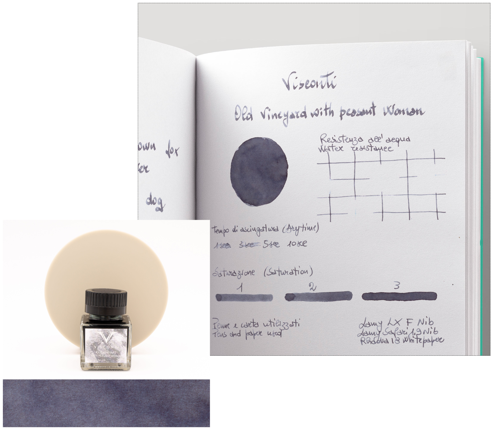
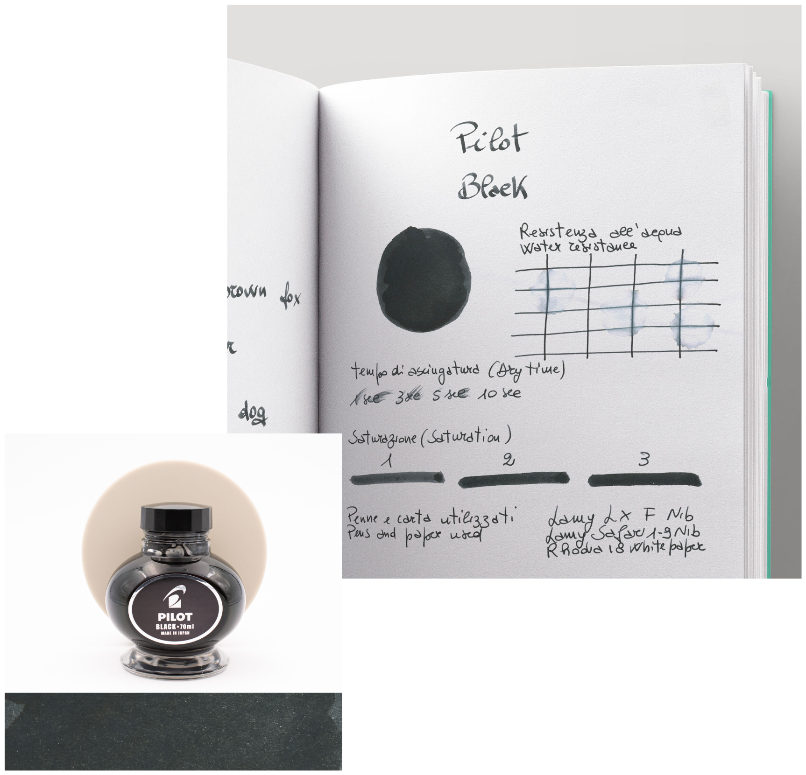
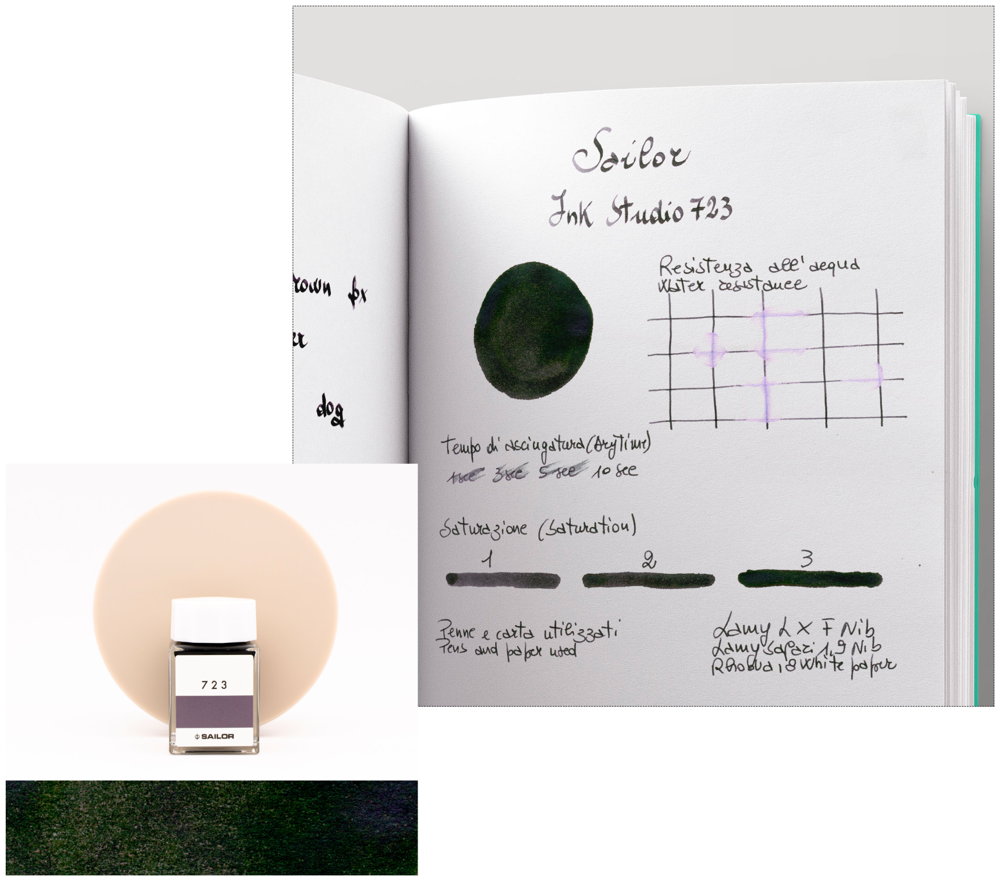
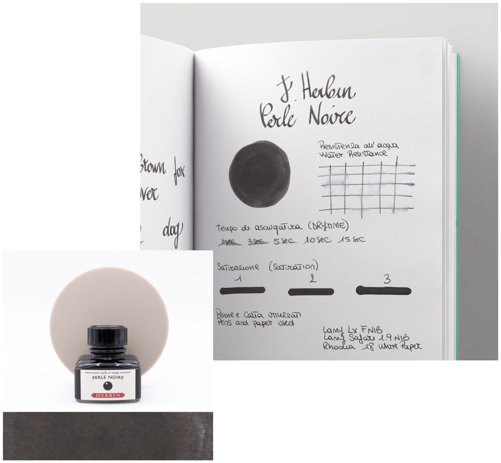
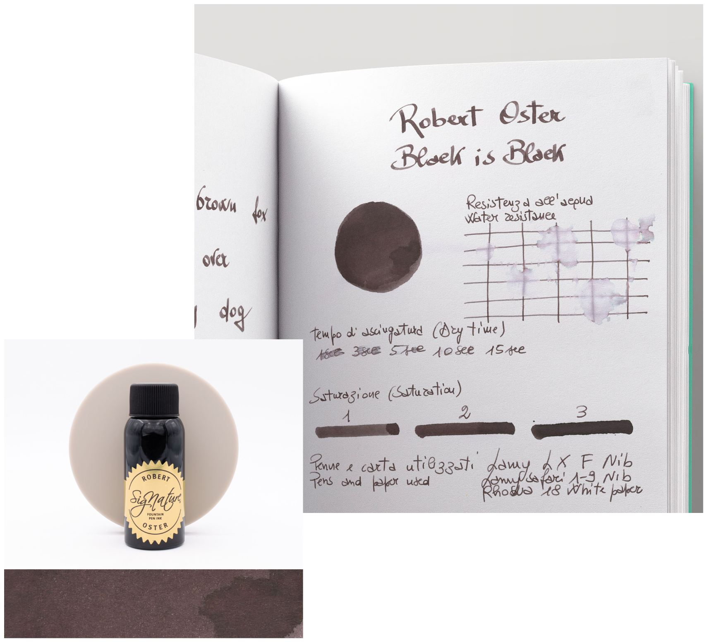

+++
date = '2025-08-18'
draft = false
title = 'Greyish Inks from Stilo&Stile'
description = 'A collection of different inks from Stilo&Stile in grayish and darkish themes, useful for formal documents.'
summary = 'A collection of different inks from Stilo&Stile in grayish and darkish themes, useful for formal documents.'
toc = true
autonumber = true
+++
## Lighter Gray Inks
### Pilot kiri-same
> *Kiri-same translates to "Misty Rain" or "Autumn Shower". This light grey ink with warm tones captures the soft and melancholic atmosphere of an autumn drizzle. It is a very popular color for its discreet elegance and beautiful nuances.*

[Pilot Iroshizuku kiri-same Ink Bottle 50 ml | Stilo&Stile ➚](https://www.stiloestile.com/en/inks/bottled-inks/pilot-iroshizuku-kiri-same-ink-bottle-50-ml)  
**€25.00**
### Pilot fuyu-syogun
> *Fuyu-syogun translates to "Old Man Winter". This cool and subtle gray ink, with hints of blue and violet, captures the beauty of a harsh winter landscape. It is a very popular color for its elegance and sobriety.*

[Pilot Iroshizuku Fuyu-Syogun Ink Bottle 50 ml | Stilo&Stile ➚](https://www.stiloestile.com/en/inks/bottled-inks/pilot-iroshizuku-fuyu-syogun-ink-bottle-50-ml)  
**€25.00**
### Visconti Van Gogh Old Vineyard with a Peasant Woman
> ***Based on*** [Vang Gogh's painting with the same name ➚](https://www.vangoghmuseum.nl/en/collection/d0446V1962).  
> *"Van Gogh began with a pencil drawing. Then he added oil paint and watercolour in many different shades of blue. He painted some of the roofs red, but these have since faded to brown. Because he left large areas of the paper blank, the colour white plays a large role in the scene."*

[Visconti Van Gogh Old Vineyard with Peasant Woman Ink Bottle 30 ml | Stilo&Stile ➚](https://www.stiloestile.com/en/inks/bottled-inks/visconti-van-gogh-old-vineyard-with-peasant-woman-ink-bottle-30-ml)  
**€14.00**
## Darker Gray / Black Inks
### Pilot Black
> *"The perfect choice for those who seek intense, bold black with a smooth, effortless flow. Designed for fountain pen lovers, professionals, and creatives, this ink delivers consistent saturation, quick drying, and fade resistance for a flawless writing experience.  Pilot Black Ink is ideal for daily writing, formal documents, and artistic expressions, ensuring crisp and long-lasting impressions every time."*

[Pilot Black Ink Bottle 70 ml | Stilo&Stile ➚](https://www.stiloestile.com/en/inks/bottled-inks/pilot-black-ink-bottle-70-ml)  
**€17.50**
### Sailor Ink Studio 723
> *"Sailor Ink Studio #723 fountain pen ink is a very dark shade of purple that leans heavily toward black that comes from the Ink Studio Collection which consists of over 100 dye-based colors."*

[Sailor Ink Studio 723 Ink Bottle 20 ml | Stilo&Stile ➚](https://www.stiloestile.com/en/inks/bottled-inks/sailor-ink-studio-723-ink-bottle-20-ml)  
**€15.90**
### Herbin Perle Noire
> *"Perle Noire is a black ink. It shades with a soft gradient in both print and cursive to a slightly darker, almost matte black where the ink pools. In terms of darkness, it’s generally not that black in writing. Especially when writing with larger nib sizes, a lot of grey can come through."*

[Herbin Perle Noire Ink Bottle 30 ml | Stilo&Stile ➚](https://www.stiloestile.com/en/inks/bottled-inks/herbin-perle-noire-ink-bottle-30-ml)  
**€9.00**
## Johannes Wildcard and favorite
### Robert Oster Black is Black
> *"Black is Black is not a dark black, it’s more of an unsaturated black that leans almost brownish-grey in large swabs."*

[Robert Oster Black is Black Ink Bottle 50 ml | Stilo&Stile ➚](https://www.stiloestile.com/en/inks/bottled-inks/robert-oster-black-is-black-ink-bottle-50-ml)  
**€17.50**